# Gallery

Review renders of the three reference scenes and the species sheets, regenerated by
`python3 scripts/gallery.py` at every visual change. All images come from the
dependency-free preview renderer (`plandscape/render.py`: z-buffer, Lambert shading,
alpha-tested textures), not the three.js viewer, so they show exactly what the generators make.
Numbers are in [`stats.json`](stats.json); every technique named here is written out with its
equations in [`../TECHNIQUES.md`](../TECHNIQUES.md).

## Species, summer and fall (detail = low, seed 5)

Space colonisation skeletons (§2) with pipe-model radii (§3), folded leaf-sprig cards (§6) whose
grey detail textures take each species' season colour through COLOR_0 = c / μ (§5).

Dogwood's layered crown, hard tiers (top) and soft tiers (bottom), winter and summer. Hard tiers left empty gaps
that space colonisation bridged with vertical stems, giving boxy right angles. Soft tiers keep points in the gaps at
30 % density: $p(v) = 0.3 + 0.7\cos^2(\pi(\mathrm{frac}(3v) - \tfrac12))$.

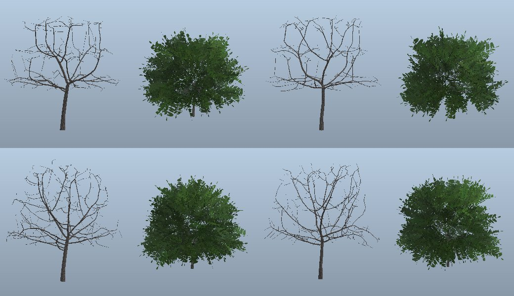

## Wind (§34)

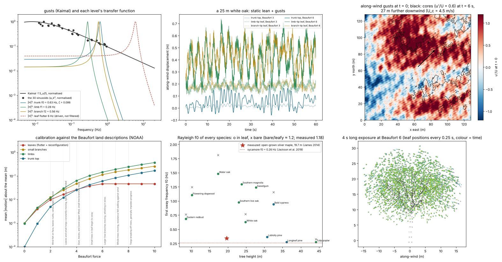

One gust field drives everything that sways. Top row: Kaimal gusts against each level's transfer function (trunk,
limb, branch, leaf flutter); a 25 m white oak's trunk top and a typical limb- and branch-tip leaf at Beaufort 3 and 6
(static lean plus gusts); the along-wind gust field, whose cores have moved 27 m downwind 6 s later. Bottom row: motion
of leaves, branches, limbs and the trunk top against the NOAA land descriptions; every species' Rayleigh sway
frequency in leaf (o) and bare (x) against two measured broadleaves (ours run high: a known gap); a 4 s long exposure.

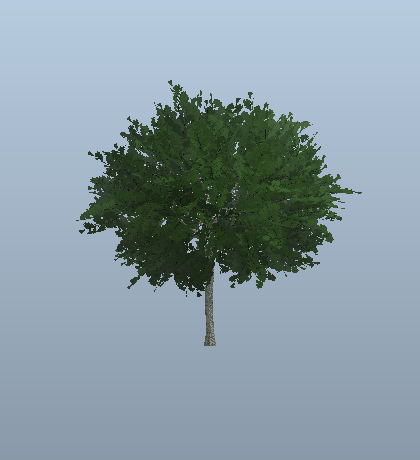

The same oak at Beaufort 6, rendered from the viewer's own equations (`plandscape/wind/sway.py`).

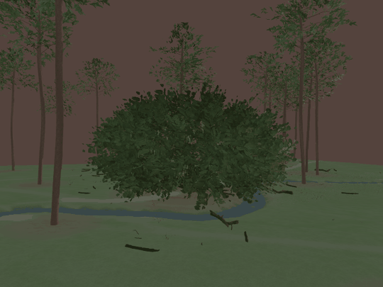

The three.js viewer on the longleaf savanna at Beaufort 7 (`scripts/wind_frames.py out/longleaf … --force 7`), frames
0.25 s apart on a fixed wind clock.

## Walking in (§35)

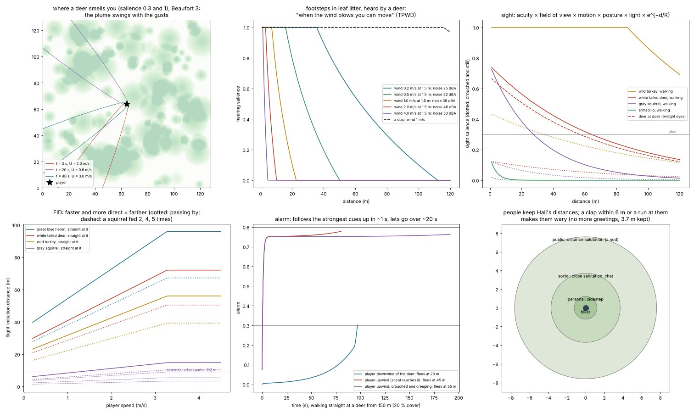

How animals sense the player: where a deer smells you (the plume swings with the gusts), how far footsteps in leaf
litter carry against the wind's noise, sight by species, flight-initiation distance by speed, directness and
feeding, a deer's alarm as the player walks at it up- and downwind, and the distances people keep.

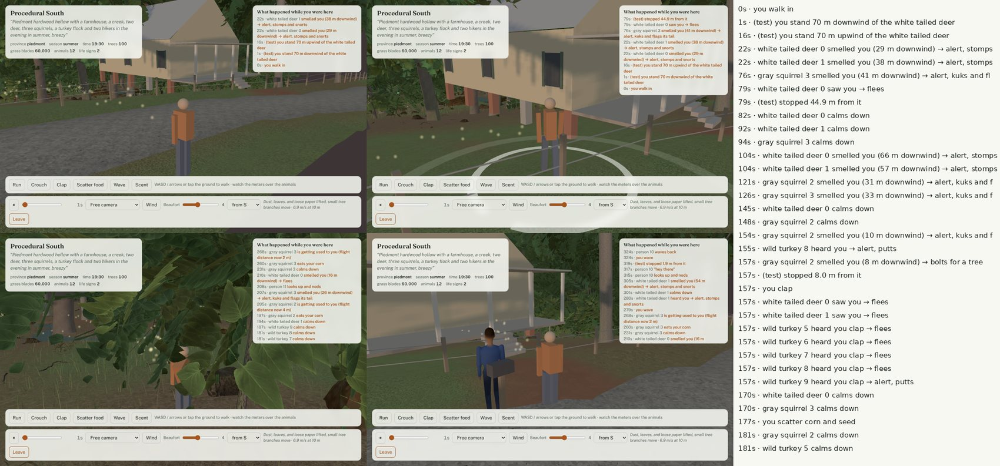

`scripts/play_check.py` on the `walk` scene: the player stands downwind, then upwind of the deer (they smell it and
slip away), walks at them, claps at the squirrels, scatters corn and steps back, then meets the hikers.

## Animals (§32, sculpted §36)

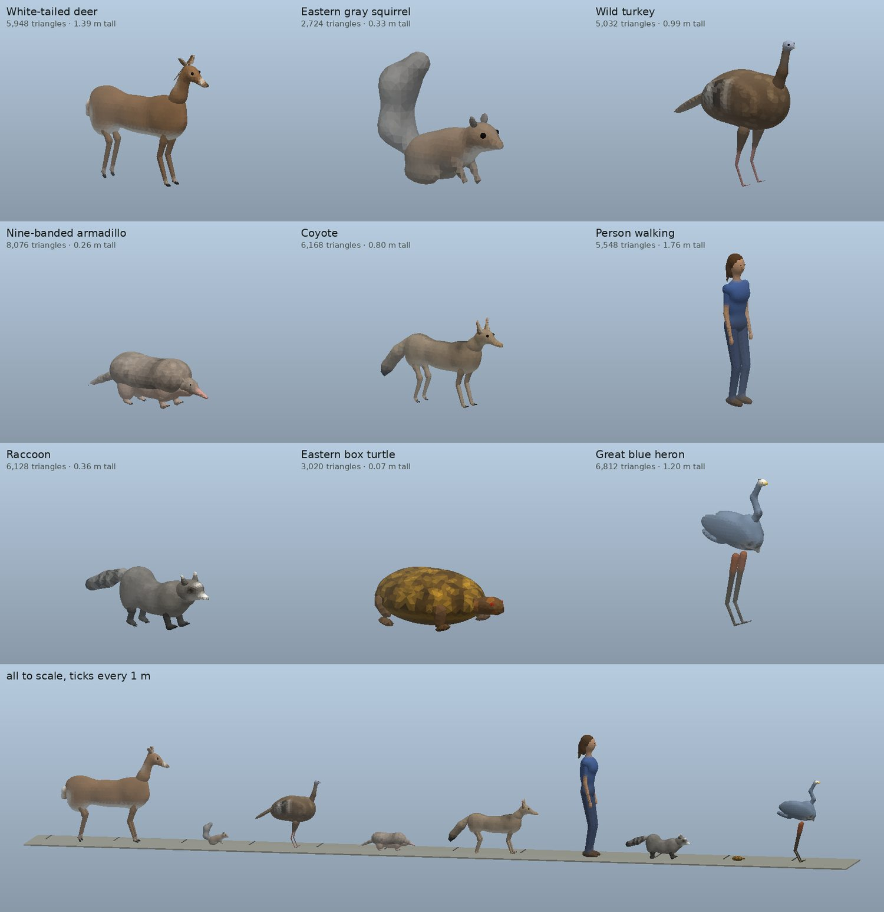

Every species sculpted from blended anatomical forms and meshed as one smooth skin: portraits in three-quarter view
with their triangle counts and heights, then all of them to scale on a 1 m-ticked ground. Markings follow the
sources: the deer's white throat, eye ring, muzzle band and flag; the coyote's black-tipped brush and dorsal stripe;
the raccoon's mask and ringed tail; the armadillo's nine bands; the turkey's bare blue head, snood and beard; the
heron's dagger bill and black plume; the box turtle's rayed scutes.

## Sex and season (§37)

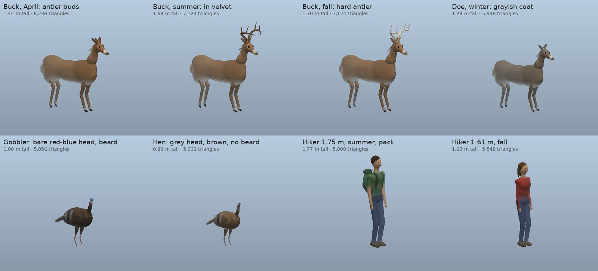

A buck through the antler year on the Missouri Department of Conservation calendar: buds in April, velvet in
summer, hard antler in fall. Then a doe in her grayish winter coat, and a gobbler and a hen (grey feathered head, no
beard, 0.9 the size). Last, two hikers at the NHANES mean statures, one carrying a pack. Each row shares one frame,
so the sizes are to scale.

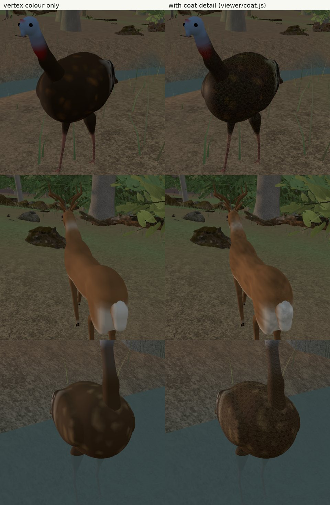

The viewer's coat shader (`viewer/coat.js`), off (left) and on (right): fur strands and tufts on a velvet buck,
feather scallops and bronze-green iridescence on a gobbler, and a hen's duller buff-tipped feathers.

## Heron flight (§33)

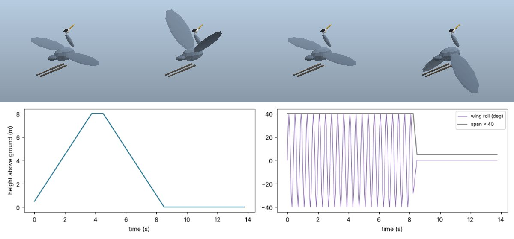

A flushed heron in four wingbeat phases (legs trailed, head drawn back), its height through a flight, and the wing
roll and span keys that fold the wings again on landing.

## Gaits (§25)

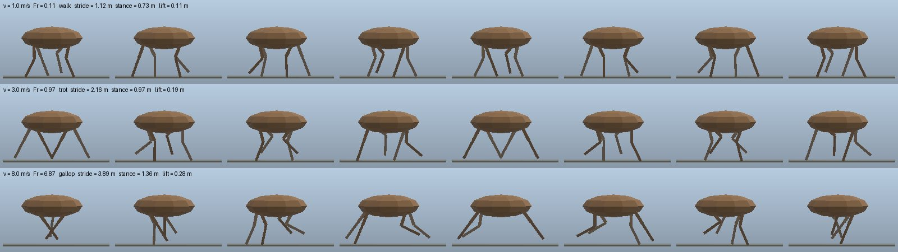

The deer rig through one stride at 1, 3 and 8 m/s. The Froude number picks walk, trot or gallop, and stride follows
λ = 2.3 h Fr^0.3. Feet follow stance and swing paths, and hips and knees come from two-bone IK (§26), the same
angles keyed into the GLB by stride phase. The grey line is the ground.

## Poses by behaviour (§28–29)

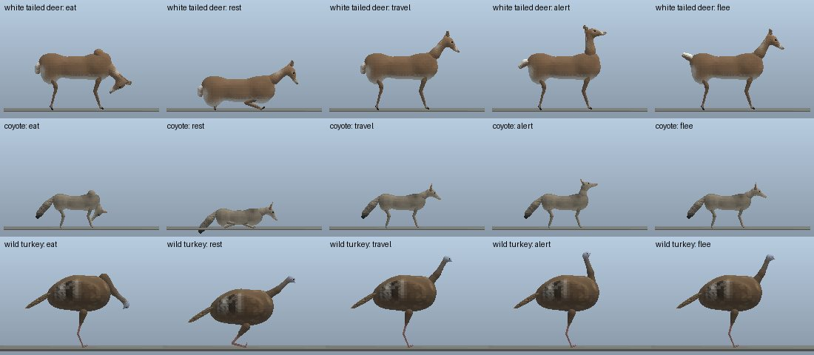

The head pitches by the agent's logged state: down to eat or drink, raised when alert. Resting animals lie down,
with legs folded by the same IK, and a fleeing deer raises its white flag. The same keys drive the GLB's nodes.

## Turning (§30)

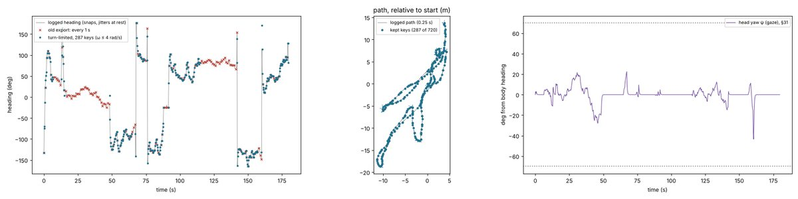

A stored deer clip: the logged heading (grey) snaps and jitters while the deer stands; the old export (red) sampled it
once a second. The exported heading (blue) turns at no more than 4 rad/s, holds still at rest, and keeps 287 of 720
keys (middle: the path with its kept keys and headings). Right: the head's gaze, the heading the body no longer
follows, up to ±70° (§31).

## Terrain: droplet erosion (§14)

Same tiles without (top) and with (bottom) batched droplet erosion: gullies on the escarpment and ridge
slopes, the plateau's sandstone cap left intact, sediment filling the hollows.

## Creeks (§21)

Priority-Flood routing, jittered D8, traced and pruned networks, hydraulic-geometry widths (blue: wetted
channel) and Kinoshita meanders (red: centrelines) that loop on flat ground and only wander on steep ground. One
bayou is laid across flat country.

## Monte Sano hardwood cove, fall, golden hour (Cumberland Plateau)

The same scene in the three.js viewer (`scripts/viewer_shot.py`, headless Chromium, software WebGL):
detiled splat ground (§20), wind with leaf flutter, the event log of what the animals did.

Far LOD (§23): the same view with tree impostors beyond 110 m (left) and full meshes everywhere (right).

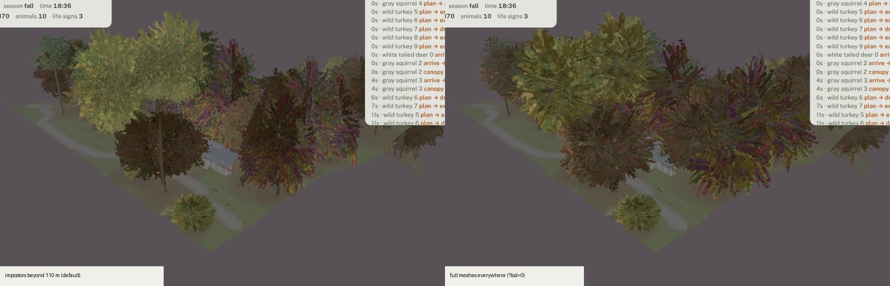

Homestead: the county road routed by Dijkstra on a slope cost, smoothed, cut and filled with a crown and
ditches (§15); the fence leaves a gate where the trodden walk from the porch meets the mailbox.

Close-up: photoscanned logs, a mossy boulder, stumps, ferns and deadfall placed by habitat-weighted
rejection scatter (§11), decimated by vertex clustering (§10). Map: active-walker desire paths (§7)
in orange, animal tracks driven by softmax choice (§8) and Ornstein–Uhlenbeck heading noise (§9).

## Longleaf pine savanna near Mobile (Coastal Plain)

## Cypress bayou floodplain, summer noon (Delta)

